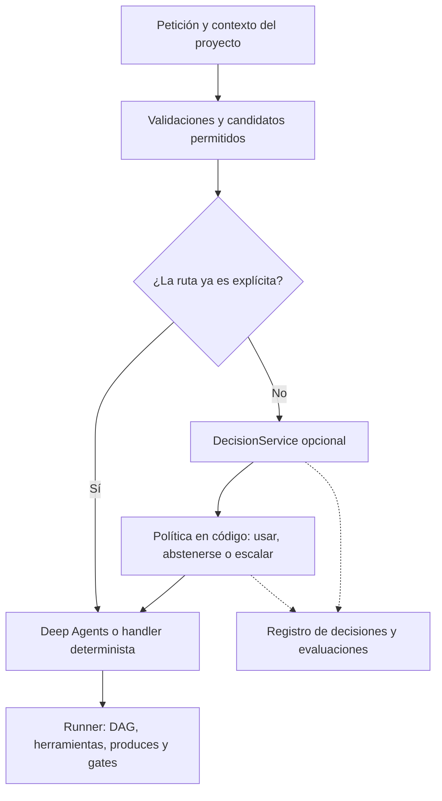

# Jev y modelos de decisiones estructuradas para el backend de DSAgent

Fecha de consulta: **2026-09-21**. Estado: **investigación y propuesta; integración no implementada**.

## Recomendación

Evaluar Jev como un **servicio opcional de decisiones semánticas**, detrás de una interfaz independiente del proveedor. Mantener Deep Agents para razonar, generar código y utilizar herramientas; mantener el runner para ejecutar el DAG y verificar sus contratos.

El primer experimento debería sugerir una ruta o skill entre candidatos permitidos, sin ejecutar acciones por esa decisión. Después, si las mediciones lo justifican, evaluar selección de modelos por paso. La revisión semántica de herramientas es una tercera aplicación, complementaria a permisos y aislamiento.

**No hay evidencia de rendimiento de Jev en DSAgent todavía.** Esta investigación revisó documentación, código oficial y el repositorio local. No se instalaron paquetes, no se usaron credenciales ni se enviaron conversaciones, archivos o código del proyecto a la API de TypeSafe. Las cifras de proveedores se distinguen de los cálculos y propuestas propios.

## 1. Qué es Jev y qué significa para el desarrollo

LangChain presenta Jev como un modelo de TypeSafe orientado a decisiones estructuradas, complementario al LLM del agente. Su artículo del 17 de septiembre propone aplicarlo al routing y a la inspección de llamadas a herramientas. No es un reemplazo directo del modelo conversacional. [Artículo de LangChain](https://www.langchain.com/blog/building-a-harness-with-jev).

La interfaz recibe un estado y preguntas acotadas. Sus primitivas son:

| Primitiva | Resultado | Ejemplo propuesto en DSAgent |
|---|---|---|
| `Choice` | Opción de un conjunto y distribución de probabilidades | Elegir entre workflows disponibles o `none` |
| `Noul` | Probabilidad de una condición sí/no | ¿La petición contiene información suficiente para recomendar un workflow? |
| `Score` | Puntuación sobre niveles declarados | Grado de correspondencia entre un entregable y una rúbrica |

Las preguntas de una misma llamada comparten el estado, pero sus respuestas son independientes; una respuesta no alimenta automáticamente la siguiente. Preguntas que requieren nueva evidencia sí necesitan otra llamada. [Primitivas oficiales](https://docs.typesafe.ai/primitives).

Para **construir el backend**, su ayuda sería indirecta: clasificar incidencias entre módulos, ordenar fallos de evaluaciones o recomendar qué especialista/modelo revisar un cambio. Son hipótesis de aplicación, no capacidades evaluadas aquí. Escribir endpoints, diseñar transacciones, corregir concurrencia y producir parches siguen siendo tareas para desarrolladores y modelos generativos, verificadas con herramientas convencionales.

TypeSafe también publica una skill para dar a agentes de programación contexto sobre su API. Esa skill documenta la integración; no convierte Jev en un agente de programación. [Agent skill oficial](https://docs.typesafe.ai/agent-skill).

## 2. Qué está documentado y qué no debemos asumir

### Disponibilidad y límites

La documentación consultada identifica `jev-1.13.0`; `jev-latest` y `jev-preview` apuntan a esa versión. Publica un precio de **USD 0.042 por millón de tokens de entrada**, salida gratuita, entrada solo de texto y límites de contexto de 64k por solicitud y 32k para estado más la pregunta más larga. Indica mejor desempeño en inglés. Los límites publicados son 1,200 solicitudes/minuto y 250,000 tokens/segundo, sujetos a cambios. Conviene fijar el ID del modelo, porque los alias pueden cambiar sus respuestas. [Modelos](https://docs.typesafe.ai/models).

No presupongo disponibilidad de pesos para ejecutar Jev localmente: las fuentes examinadas describen el acceso por servicio. Una URL de gateway configurable tampoco demuestra que el modelo pueda autohospedarse.

### Evidencia del proveedor

TypeSafe atribuye sus mejoras a RLCD y evaluación paralela. Publica resultados de hasta 193.6× en velocidad y 444.6× en costo en sus evaluaciones de workflows. La propia publicación reconoce que son ganancias del extremo alto y que la referencia es el promedio de predicciones de otros modelos, no etiquetas humanas de verdad objetiva. Son resultados del proveedor, no una validación independiente ni una predicción sobre nuestro producto. [Anuncio y metodología](https://typesafe.ai/blog/introducing-system-one-models-and-jev).

El formato correcto no demuestra corrección semántica. TypeSafe documenta dificultades con aritmética, fechas, razonamiento indirecto, contexto irrelevante e instrucciones adversariales; también advierte que probabilidades de preguntas separadas no necesariamente respetan las identidades que esperaríamos entre ellas. [Limitaciones de Jev 1.13](https://docs.typesafe.ai/model-jaggedness/jev-1.13).

`confidence` resume la concentración de la distribución de `Choice`/`Score`; no significa automáticamente «porcentaje de aciertos en DSAgent». Los umbrales se deben ajustar por tarea con datos separados para evaluación. `Noul` no lleva ese campo adicional. [Confidence](https://docs.typesafe.ai/confidence).

## 3. Encaje con el código actual

Inspección local del árbol de trabajo, con cambios sin commit de otras tareas; las referencias de línea pueden desplazarse. Entorno instalado leído mediante `importlib.metadata`: Deep Agents 0.7.14, LangChain 1.4.0, langchain-core 1.6.3, LangGraph 1.2.11 y Pydantic 2.13.5.

| Punto del backend | Evidencia local | Implicación para una integración |
|---|---|---|
| Orquestador | `src/dsagent/host/build.py`, `build_orchestrator`, acepta `middleware` | Existe una extensión natural sin reconstruir el ciclo del agente |
| Agentes de pasos | Mismo archivo, `build_persona_agent`, construye cada agente con `checkpointer=False` | Requiere cableado explícito; no asumir cobertura por configurar solo el orquestador |
| Subagentes de chat | Mismo archivo, colección `subagents` | Verificar propagación y orden del middleware en esta ruta por separado |
| Runner | `src/dsagent/runner/runner.py`, `run`, `_run_step`, `_gate` | El DAG, `produces` y las aprobaciones continúan siendo deterministas |
| Selección de workflow | `src/dsagent/runner/tools.py`, `workflow_tools` | Construir candidatos desde el cartridge y los permisos, nunca desde nombres inventados |
| Proyecto/cartridge | `src/dsagent/serve.py`, `cartridges_for` y `chat_agent_for` | Resolver y validar el dominio antes de clasificar; ninguna predicción concede acceso |
| Costos | `src/dsagent/runner/runner.py`, `_record_cost` | Hoy infiere el modelo desde la persona/default; un router dinámico exige registrar el modelo real |
| Ejecución local | `src/dsagent/envs/kernel.py`, `make_kernel_env` | Usa shell local y kernel; un clasificador no crea aislamiento del sistema operativo |

Observación adicional: `cartridges_for` contiene un fallback a todos los cartridges cuando no encuentra el vinculado. Antes de añadir clasificación, hay que probar y resolver el caso de un cartridge retirado. El clasificador no debe ocultar ni decidir ese comportamiento.

### Oportunidades ordenadas

1. **Recomendar workflow o especialista al interpretar una petición ambigua.** Filtrar candidatos por proyecto y capacidades; ofrecer abstención y conservar al orquestador como fallback. Un comando explícito o una selección en la UI no necesita esa llamada.
2. **Sugerir skills cuando crezca el catálogo.** Respetar `skills_for(persona)` y el scope validado por el loader. La predicción ordena opciones ya permitidas, no modifica permisos ni instala skills. Con pocos skills, el ahorro puede ser menor que el costo de integrar otro servicio.
3. **Seleccionar el modelo por tarea/paso.** Empezar comparando contra reglas estáticas por persona y workflow. Mantener fija la elección durante el paso y persistirla para reanudaciones. Respetar un modelo fijado explícitamente por usuario/operador.
4. **Comprobar aspectos semánticos de entregables.** Por ejemplo, correspondencia con un brief, presencia de una justificación o apoyo documental de una afirmación. Que exista el archivo, su esquema, sumas y demás invariantes verificables siguen comprobándose con código.
5. **Señalar acciones potencialmente riesgosas.** Puede añadir señales de revisión antes de ejecutar herramientas, pero no reemplaza autorización, límites de red/filesystem ni gates humanos.

Existe un cookbook especialmente relevante para skills: usa una primera selección y luego revisa tres candidatos, conservando la posibilidad de no recomendar ninguno. Reporta menos errores sobre un catálogo de Hermes; ese experimento usa Jev 1.12 y otro agente, por lo que solo lo tomaría como diseño de experimento. [Skill suggestion](https://docs.typesafe.ai/cookbooks/skill_suggestion).

Para revisar entregables, TypeSafe muestra un patrón que contrasta una afirmación con su fuente. Nuestra aplicación tendría que aportar esa fuente y medir falsos positivos; no sería una certificación automática de exactitud. [Double-checking citations](https://docs.typesafe.ai/cookbooks/citation_check).

## 4. Arquitectura propuesta



Nombres propuestos, aún inexistentes:

```text
src/dsagent/decisions/
  contracts.py          # DecisionRequest / DecisionResult
  service.py            # timeout, modo, fallback y registro
  providers/typesafe.py # adaptador reemplazable
  middleware.py         # integración en los hooks de Deep Agents
```

El contrato debería conservar: versión de esquema, ID y tipo de decisión, candidatos, respuesta, probabilidades, confianza cuando exista, modelo efectivo, versión de política, tokens, latencia, error/fallback y referencias de proyecto/run/paso. Un identificador o hash del contexto facilita auditoría sin copiar secretos al log.

Las preguntas de dominio pertenecen al cartridge, en una sección o archivo de decisiones separado de la presentación de UI. Las restricciones globales y permisos pertenecen al operador. Un cartridge no puede rebajar esas restricciones ni transformar una sugerencia en autorización.

Tres modos propuestos: `off`, `observe` y `enforce`. En `observe` se registran predicciones sin alterar ejecución; en `enforce` solo se activan los usos que hayan superado su evaluación. Timeout, 429 o abstención en routing vuelven al camino actual; una comprobación obligatoria de riesgo fallida mantiene bloqueada/pendiente la acción. No usar un fallback único para ambos casos.

### Integración LangChain: útil, pero no copiarla sin adaptación

`TypeSafeClassifier` es un `Runnable`, no un `BaseChatModel`: no se coloca en `DSAGENT_MODEL`. Acepta estado/preguntas en `invoke` y permite composición con middleware. Los dos middleware preconstruidos se distribuyen bajo un módulo experimental. [Integración oficial](https://docs.langchain.com/oss/python/integrations/providers/typesafe).

El código oficial de `ModelRouterMiddleware` clasifica el último mensaje humano, conserva una elección para la invocación y propaga errores del clasificador. Para DSAgent propondría un adaptador propio que incluya contexto del paso, respete overrides y defina fallback, en lugar de insertar ese router como dependencia obligatoria. [Implementación del router](https://raw.githubusercontent.com/langchain-ai/langchain/master/libs/partners/typesafe/langchain_typesafe/experimental/middleware/model_router.py).

`AutoModeMiddleware` inspecciona solo herramientas enumeradas, recibe hasta 30 mensajes recientes y devuelve un error en vez de ejecutar si detecta riesgo. No abre una aprobación humana. El código consultado usa un umbral interno de 0.5 y propaga fallos sin llamar a la herramienta. En DSAgent habría que cubrir `execute`, `run_python`, `run_skill_script` y las rutas de escritura pertinentes; cubrir solo una herramienta de shell deja otras vías sin revisar. [Implementación de AutoMode](https://raw.githubusercontent.com/langchain-ai/langchain/master/libs/partners/typesafe/langchain_typesafe/experimental/middleware/auto_mode.py).

El manifiesto de la rama consultada declara `langchain-typesafe` 0.0.1a3, `langchain-core>=1.6.2,<2` y, para experimental, `langchain>=1.3.15,<2`. Las versiones locales satisfacen esos rangos; esto no demuestra compatibilidad completa de dependencias ni ejecución. Habría que fijar una release disponible, resolver en un entorno aislado y probar rutas síncronas/asíncronas y reanudaciones. [Manifiesto oficial](https://raw.githubusercontent.com/langchain-ai/langchain/master/libs/partners/typesafe/pyproject.toml).

## 5. Costos y condiciones operativas

Cálculo ilustrativo propio usando la tarifa publicada arriba, **sin mediciones de DSAgent**:

```text
2,000 tokens totales de entrada por decisión
100,000 decisiones × 2,000 / 1,000,000 × USD 0.042 = USD 8.40
```

El supuesto incluye estado y preguntas. Dos llamadas, reintentos y más contexto incrementan ese valor. No incluye los modelos generativos, infraestructura, evaluación ni trabajo de integración. El indicador útil es costo por trabajo satisfactorio, no precio por llamada.

Una mejora local tampoco se traslada íntegra al workflow: si, hipotéticamente, el 40% del tiempo fuera clasificación y esa parte se acelerara 100×, la aceleración total sería `1 / (0.60 + 0.40/100) ≈ 1.66×`, antes de añadir red o fallback. Si la mayor parte se consume generando código o ajustando modelos, el beneficio será distinto.

Las solicitudes añaden un proveedor que recibe el contexto enviado. La documentación legal declara compromiso de no entrenar con datos del usuario y ZDR disponible para clientes enterprise; no equivale a retención cero por defecto. Para el piloto: texto sintético o autorizado, contexto mínimo y logs sin contenido sensible. Confirmar condiciones aplicables antes de usar datos de clientes. [Documentación de tratamiento de datos](https://docs.typesafe.ai/legal).

## 6. Alternativas y comparaciones que sí tienen sentido

| Alternativa | Cuándo la evaluaría | Diferencia relevante |
|---|---|---|
| Reglas y validación Pydantic | IDs, permisos, opciones, límites, campos obligatorios | Primera opción si la respuesta es calculable exactamente |
| LLM actual con salida estructurada | Baseline para decisiones que ya toma el agente | Permite medir si se gana algo añadiendo otro modelo |
| Jev | Decisiones semánticas acotadas y repetidas | Servicio externo; probar exactitud, calibración y latencia propias |
| GLiNER2.5 | Extracción y clasificación local, especialmente si se busca despliegue propio | Pesos publicados; costos y operación pasan a nuestra infraestructura |
| LangExtract | Extraer información de documentos y rastrearla al texto original | Biblioteca basada en LLM, no un modelo de la misma categoría |

Fastino publica GLiNER2.5 con variantes de 74M, 0.2B y 0.3B parámetros, incluida una multilingüe, extracción y clasificación con restricciones. Declara pesos bajo Apache 2.0. Lo compararía en el subconjunto de tareas coincidentes; no asumo que su score tenga la misma calibración que Jev ni que el modelo más reciente gane en todas las tareas. [Fuente oficial de Fastino](https://fastino.ai/blog/gliner2-5-span-free-information-extraction).

Google describe LangExtract como una biblioteca para extracción estructurada con referencias a posiciones del texto fuente. Sería pertinente para ingestión de briefs/documentos; no reemplaza el servicio de decisiones ni el runner. [Repositorio oficial de Google](https://github.com/google/langextract).

## 7. Piloto y tareas propuestas

Estas tareas son una propuesta de investigación, **no sustituyen las prioridades de** [BACKLOG.md](../reviews_2/BACKLOG.md) **ni autorizan una migración general**.

| ID | Trabajo | Evidencia necesaria para cerrarlo |
|---|---|---|
| JEV-01 | Medir el baseline actual | Tiempo y costo por etapa; errores de ruta/skill; fracción del trabajo que realmente puede optimizarse |
| JEV-02 | Construir un conjunto bilingüe de evaluación | Peticiones DS/marketing, ambiguas, sin ruta válida y adversariales; etiquetas revisadas; particiones separadas de ajuste y prueba |
| JEV-03 | Crear contrato y proveedor falso | Tests deterministas de timeout, abstención, respuesta inválida, candidatos no permitidos y trazabilidad; ninguna dependencia de red |
| JEV-04 | Añadir adaptador opcional en modo observación | API fijada y contexto mínimo; ejecución normal idéntica; errores no interrumpen el producto |
| JEV-05 | Comparar recomendación de workflow/skill | Baseline vs Jev: exactitud por clase, abstención, cobertura, latencia p50/p95, costo y calidad final; pruebas separadas en español |
| JEV-06 | Evaluar routing de modelos por paso | Modelo efectivo y costo registrados; respeto de overrides; elección persistida al reanudar; comparación contra routing estático |
| JEV-07 | Evaluar revisión semántica de herramientas | Matriz de cobertura orquestador/subagentes/pasos; pruebas adversariales; errores conservadores; gates y permisos intactos |
| JEV-08 | Decidir adopción o descarte | Informe reproducible, costo por éxito, fallos conocidos y rollback probado; habilitar solo los usos que compensen |

Empezaría con unas 200–300 peticiones revisadas para descubrir fallos y ajustar el experimento; ese volumen **no certifica seguridad ni errores raros**. Congelar preguntas/umbrales antes de evaluar el conjunto reservado. Medir también calibración (por ejemplo Brier/reliability) y calidad frente a cobertura de las decisiones aceptadas, no solo acierto agregado.

Criterio de decisión: ahorro o mejora observables frente al baseline, dentro de un margen de calidad definido antes del ensayo; resultados por dominio/idioma y con incertidumbre estadística. Si no hay una ventaja clara, conservar reglas y orquestador actual. Para riesgo, cero escapes en una batería de prueba es una condición útil, pero nunca prueba suficiente para retirar aislamiento o autorización.

## 8. Alcance y límites de esta entrega

- Investigación basada en fuentes primarias consultadas el 21 de septiembre de 2026 y lectura del backend local.
- Los ejemplos de arquitectura, las prioridades y el piloto son recomendaciones propias.
- Los enlaces a ramas `master` son referencias móviles; una implementación deberá fijar release/commit y registrar la versión efectiva del servicio.
- No se ejecutó un benchmark contra Jev, GLiNER ni LangExtract. No se afirma una mejora de costo, calidad o seguridad en DSAgent.
- La UI genérica es un trabajo separado: este informe no la declara terminada ni modifica su implementación.
