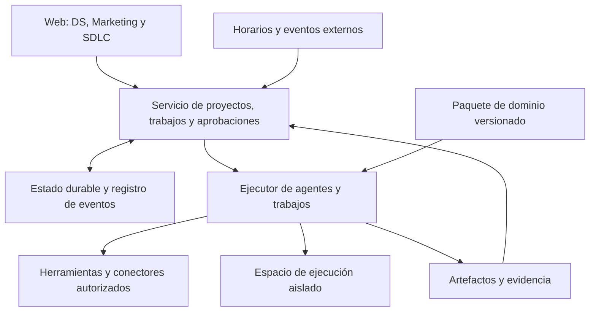

# Pausa de arquitectura: Hermes, OpenClaw, NemoClaw y tres dominios

2026-09-22 · Base local: `c7949fb` (runtime sin cambios respecto a `7a6b805`).

**Revisión posterior del mismo día:** el usuario pide evaluar requisitos y encaje sobre Deep Agents antes de proponer implementaciones comparativas. La [matriz de 48 requisitos](deep-agents-requirements-fit-2026-09-22.md) sustituye la prioridad de comparar motores propuesta aquí: recomienda conservar Deep Agents y rediseñar responsabilidades de DSAgent. Este documento conserva la investigación externa y sus alternativas como antecedentes.

**Instrucción vigente del usuario:** concentrar el producto en ciencia de datos, agencias de marketing y SDLC; pausar la implementación para evaluar el modelo de agentes persistentes y aceptar retroceder si la base exige demasiadas correcciones. No se ha autorizado ni ejecutado una migración de runtime.

## Valoración

Recomiendo una revisión estructural antes de ampliar cartridges. La propuesta es un espacio de trabajo persistente para equipos de esos tres dominios, con agentes, herramientas y trabajos recuperables. Los workflows actuales pueden ser una forma de trabajo dentro de ese espacio; no tienen por qué definir todo el producto.

Esto modifica la recomendación anterior de simplemente ampliar capacidades sobre el harness existente: conviene comparar también sustituir su capa de ejecución por un runtime existente. No hay evidencia todavía para declarar ganador a Hermes, abandonar Deep Agents o reescribir toda la aplicación. El costo ya invertido no debe decidirlo.

La web es viable como interfaz de control y revisión. No obliga a ejecutar el agente, un entrenamiento o un compilador dentro del navegador. Tampoco obliga a mezclar clientes en un único proceso con credenciales compartidas.

## Qué hacen estos proyectos

### Hermes Agent — continuidad y extensión del agente

Hermes separa sus interfaces del motor `AIAgent`, del registro de herramientas y de los entornos de ejecución. Su gateway de larga duración enruta conversaciones y activa trabajos programados; las sesiones se almacenan en SQLite. Documenta backends de terminal locales y remotos. [Arquitectura oficial](https://hermes-agent.nousresearch.com/docs/developer-guide/architecture).

Los plugins pueden registrar herramientas, hooks y comandos; existen extensiones de memoria y contexto, además de integración MCP. Es una extensión de comportamiento ejecutable, distinta de instalar instrucciones. [Plugins](https://hermes-agent.nousresearch.com/docs/user-guide/features/plugins).

Los skills pueden conservar procedimientos que el agente elabora o mejora. Ese mecanismo cambia conocimiento externo reutilizable; no demuestra por sí mismo entrenamiento de los pesos ni una mejora de calidad medida. [Skills](https://hermes-agent.nousresearch.com/docs/user-guide/features/skills).

Tiene interfaces ACP, JSON-RPC y HTTP/SSE para clientes propios. Su documentación aclara que adjuntar varios clientes a una sesión viva no implica admisión durable de prompts ante un reinicio del propietario. **Por tanto, integración disponible no equivale a resolver nuestra durabilidad.** [Integración programática](https://hermes-agent.nousresearch.com/docs/developer-guide/programmatic-integration).

**Qué tomaría:** separación entre interfaz y motor, herramientas registrables, entornos intercambiables y conocimiento persistente. Lo considero el primer candidato externo para una comparación práctica con nuestro motor, por esas superficies de integración y su implementación Python. Es una prioridad de evaluación, no una recomendación de adopción ya probada.

### OpenClaw — servicio permanente, canales y capacidades

Un gateway de larga duración coordina interfaces y clientes, incluida la web, mediante un protocolo de eventos. Las capacidades pueden vivir en nodos conectados. [Arquitectura oficial](https://docs.openclaw.ai/concepts/architecture).

Sus plugins incorporan herramientas, canales y otras capacidades de runtime; los plugins nativos cargan código en el proceso. La documentación distingue instalar/configurar una extensión de comprobar que el gateway activo la está utilizando. [Plugins](https://docs.openclaw.ai/tools/plugin).

El scheduler persiste trabajos y despierta al agente cuando corresponde. Esto permite actividad programada sin mantener una inferencia continua. [Automatizaciones](https://docs.openclaw.ai/automation/cron-jobs).

Su modelo de seguridad establece una frontera de confianza por gateway: puede ser un operador o un equipo de confianza, pero no aislamiento hostil entre clientes mutuamente no confiables. [Seguridad](https://docs.openclaw.ai/gateway/security).

**Qué tomaría:** servicio persistente, eventos, activación por horario y separación de nodos/capacidades. Evaluaría adoptar su runtime si los canales de comunicación y operación multicanal fueran el centro del producto. Hoy nuestro centro es el trabajo profesional revisable; una integración más amplia no garantiza menor costo total.

### NemoClaw — entorno gobernado y ciclo de vida

No es un tercer motor equivalente a los otros dos. NemoClaw configura y opera runtimes dentro de OpenShell: combina CLI, blueprint versionado e integración específica; OpenShell aplica las fronteras de ejecución y gestiona inferencia, credenciales y tráfico autorizado. [Arquitectura oficial](https://docs.nvidia.com/nemoclaw/latest/user-guide/openclaw/about/how-it-works).

La matriz actual incluye OpenClaw, Hermes y **LangChain Deep Agents Code**. Este último es un producto concreto basado en el SDK; eso **no certifica compatibilidad automática con nuestro backend DSAgent**. La matriz declara etapa alpha/early preview y salvedades por agente y plataforma. [Soporte publicado](https://docs.nvidia.com/nemoclaw/latest/user-guide/openclaw/reference/platform-support).

NVIDIA declara expresamente que NemoClaw no es un plano de control empresarial multi-tenant endurecido. La recuperación del sandbox tampoco prueba la recuperación de una aprobación comercial o de un efecto externo de nuestro workflow. [Preparación empresarial](https://docs.nvidia.com/nemoclaw/latest/user-guide/openclaw/reference/enterprise-readiness).

**Qué tomaría:** políticas aplicadas fuera del modelo, credenciales bajo control del operador y preparación reproducible del entorno. OpenShell/NemoClaw merece una evaluación separada de la elección del motor; no necesitamos adoptar OpenClaw para aprender de esa separación.

## Qué significa «siempre encendido» para nosotros

La propuesta distingue cuatro continuidades:

| Continuidad | Estado que debemos conservar |
|---|---|
| Servicio disponible | Capacidad de recibir mensajes, eventos y horarios aunque no haya una pestaña abierta |
| Conocimiento del proyecto | Fuentes, decisiones, contexto y procedimientos con procedencia y alcance |
| Ejecución del trabajo | Estado, responsable, intentos, aprobación, límites y resultado |
| Entorno de trabajo | Archivos, repositorio, dependencias y procesos recuperables según su tipo |

Un servicio permanente puede estar inactivo casi todo el tiempo. Un notebook persistente no conserva automáticamente el estado de un proceso empresarial; una memoria del agente no sustituye una base de datos de trabajos. El modelo debe intervenir cuando hay una tarea o decisión que lo necesita. Los cálculos largos pueden ejecutarse como procesos supervisados y generar eventos al terminar.

## Tres dominios, una base compartida y experiencias específicas

Son tres dominios amplios, no tres funcionalidades pequeñas. «Ciencia de datos en general» incluye más que EDA; se mantiene como dirección de producto, sin presentar todos sus componentes como incluidos en la primera entrega.

| Dominio | Trabajo que la arquitectura debe admitir | Primera prueba representativa propuesta |
|---|---|---|
| Ciencia de datos | Ingesta/SQL, calidad, exploración, hipótesis, experimentos, entrenamiento, evaluación, informes y entrega/seguimiento de modelos; cómputo remoto cuando proceda | Dataset versionado → exploración → dos experimentos comparables → proceso de entrenamiento que continúa sin navegador → evaluación y reporte reproducible |
| Agencias de marketing | Contexto separado por cliente/marca, investigación, estrategia, producción de texto y medios, calendario, revisión, entrega/publicación y medición | Dos marcas con contexto separado → brief → piezas → cambios solicitados → aprobación → entrega programada a destino de prueba sin duplicados |
| SDLC | Repo/revisión de origen, requerimientos, tareas, implementación, pruebas, revisión, integración y entrega | Repo existente → cambio → fallo de prueba y reparación limitada → diff → aprobación recuperable → patch |

Lo común: proyectos, miembros/permisos, trabajos, eventos, aprobaciones, herramientas, secretos y artefactos versionados. Lo específico: reglas y contexto de dominio, conectores necesarios, entornos y vistas.

La UI puede compartir navegación y componentes, pero merece vistas especializadas: experimentos/tablas en DS; piezas/calendario en marketing; diffs/pruebas en SDLC. No hay razón para imponer que todo quepa en el mismo visor Markdown o formulario. Tampoco hace falta cargar JavaScript arbitrario de cualquier cartridge: inicialmente serían tres módulos de producto mantenidos por nosotros.

## Arquitectura propuesta, aún no elegida

El paquete de dominio agruparía skills/personas, herramientas requeridas, plantillas de proceso, configuración del entorno y tipos de resultados. La plataforma decide qué capacidades concede; instalar un skill no concede credenciales ni permiso para publicar.

El ejecutor puede empezar siendo Deep Agents o un runtime externo, elegido después de una comparación. No propongo implementar soporte simultáneo para los tres ni construir una capa universal de abstracción. El contrato mínimo debe cubrir solo iniciar, observar, cancelar, pedir/responder aprobación y recuperar estado; si un runtime no puede cumplir una operación, debe hacerlo explícito.

Las aprobaciones de red o ejecución y las de negocio son distintas. Permitir acceder a una API no significa aprobar una campaña, un despliegue o gasto publicitario. DSAgent debe poseer el estado de esas decisiones, aunque delegue la ejecución.

Para el primer despliegue propondría una organización por instalación o entorno dedicado, gestionado remotamente. La ejecución podría vivir en nuestra infraestructura o en la del cliente manteniendo la web. Una instalación por agencia aún requiere límites por cliente/marca: compartir organización no autoriza mezclar documentos, memoria o cuentas.

## Conservar, reemplazar o retroceder

| Alternativa | Ventaja | Costo/riesgo | Valoración actual |
|---|---|---|---|
| Seguir ampliando YAML y el runner actual | Aprovecha el recorrido existente | Puede seguir forzando recursos y procesos distintos a las mismas etapas | No continuar así sin validar los tres recorridos |
| Rediseñar ejecución/estado conservando Deep Agents | Reutiliza el bucle de agente y piezas propias | Seguimos manteniendo herramientas, operación y recuperación | Candidato principal junto a Hermes |
| Adoptar Hermes detrás de nuestra experiencia | Reutiliza herramientas, memoria y superficies de integración | Migración de eventos, permisos, gates y estado; evolución upstream | Comparar sobre trabajo real, sin asumir que es drop-in |
| Adoptar OpenClaw como base | Puede simplificar una oferta centrada en canales y automatización | Más adaptación si nuestro centro es el workspace profesional | Reconsiderar si los canales pasan a ser requisito central |
| Reescribir toda la aplicación | Libertad para cambiar el modelo | Rehacer UI, aprendizaje y capacidades que quizá sí sirven | Sin evidencia que lo justifique todavía |

La UI/identidad, los procedimientos útiles y los casos de prueba son activos aprovechables. Los contratos actuales de API, de cartridge y del driver no tienen que conservarse si impiden el producto. El `Driver` ya ofrece una interfaz pequeña, pero su implementación atraviesa el orquestador y checkpoints del framework; no es todavía un adaptador universal.

El código actual ya contiene persistencia de runs y una ruta de checkpoints SQLite, además de caminos en memoria. No sería correcto diagnosticar «no persiste nada». Hay que demostrar qué se recupera al fallar cada propietario del trabajo y qué efectos se repiten.

**Criterio para retroceder:** si el recorrido SDLC o los trabajos largos de DS solo funcionan agregando excepciones de dominio al runner, duplicando estado entre conversación y trabajo, o eludiendo permisos, sustituir esa capa. Si un runtime externo exige más adaptación y pierde garantías necesarias, conservar Deep Agents y reemplazar únicamente el control de ejecución. Los resultados deben poder invalidar cualquiera de las dos preferencias.

## Secuencia de evaluación propuesta

1. Definir los tres recorridos anteriores, fixtures, límites de aceptación y qué acciones externas se simulan.
2. Ejecutar primero el recorrido SDLC en una rama/entorno de evaluación: compara el enfoque actual con una integración mínima de Hermes. Mismo modelo cuando sea posible, mismos inputs y presupuestos; registrar diferencias inevitables y versiones exactas. Sin instalar agentes globales ni conectarlos a cuentas productivas.
3. Sobre la opción más prometedora, comprobar DS de larga duración y separación de marcas/aprobaciones de marketing. Un éxito SDLC no decide los tres dominios.
4. Probar cierre de navegador, reinicio del ejecutor, cancelación, reintento, denegación de herramienta y ausencia de efectos duplicados. Medir intervención manual, costo, latencia y complejidad del código específico mantenido.
5. Elegir arquitectura mediante ADR: conservar, reemplazar parcialmente o adoptar runtime. Si ninguna pasa, rediseñar antes de ampliar funciones. Hacer explícitos los estados/datos que se migran y los que no pueden recuperarse.

No instalar un catálogo enorme ni construir un marketplace para esta prueba. Para aprender de la idea de «expandirse», basta un registro de capacidades, paquetes versionados y procedimiento de activar/desactivar/volver a una versión anterior. Skills aprendidos quedarían como borradores del proyecto, probados y aprobados antes de promoverlos a otros clientes. La actualización no debe cambiar las capacidades de una ejecución en curso.

## Alcance de esta investigación

Lectura del código local y documentación oficial consultada el 2026-09-22. Las páginas externas son móviles: no se fijaron releases, no se auditó todo el código externo, no se instalaron los tres productos y no hay benchmark comparativo. Las conclusiones sobre encaje son juicio arquitectónico; las capacidades externas se atribuyen a sus fuentes.

Evidencia local principal: `src/dsagent/driver.py` (contrato y propietario del run), `serve.py` (construcción de agentes y checkpoints), `host/build.py` (herramientas y motor), `runner/runner.py` (etapas y gates), `cartridge/models.py` (contrato de extensión) y `cartridges/marketing/cartridge.yaml` (alcance documental actual).

La pausa y los tres dominios provienen del usuario. La arquitectura propuesta y la prueba comparativa siguen pendientes de adopción. Este documento complementa la [valoración de flexibilidad](harness-extensibility-assessment-2026-09-22.md); no marca como realizadas tareas del backlog ni implementa la migración.
